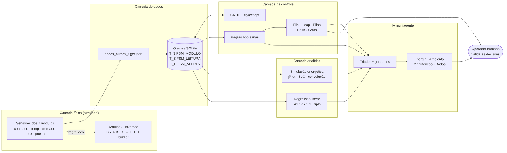
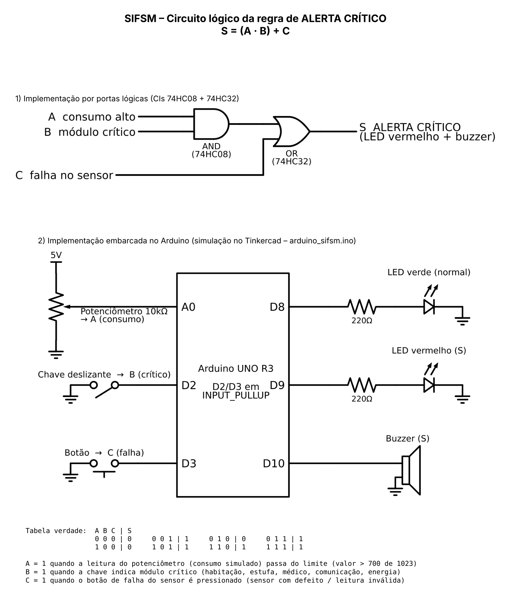
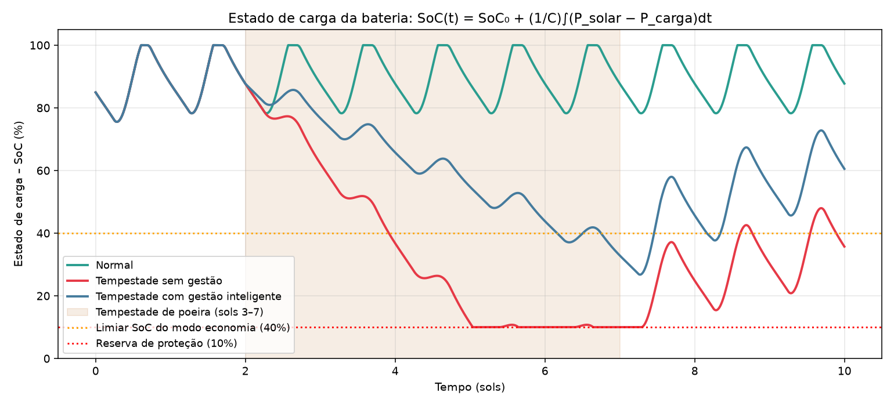
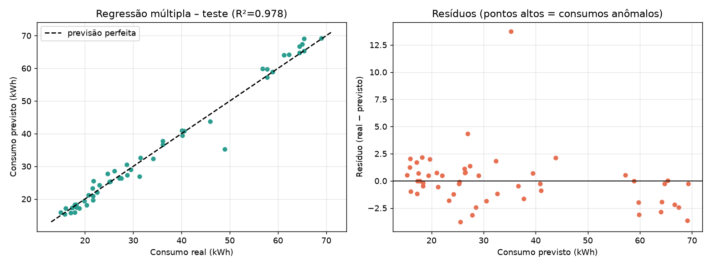

# Relatório Técnico – SIFSM

## Sistema Integrado de Futuro Sustentável em Marte · Colônia Aurora Siger

**FIAP – Ciência da Computação – Atividade Integradora**
Autor: Denis Urbano Cereto (RM569187) – projeto individual

---

## 1. Contexto da solução

A Aurora Siger é uma colônia de 12 tripulantes formada por 7 módulos: habitação, estufa agrícola, laboratório, comunicação, suporte médico, armazenamento e central de energia. Em Marte, energia é o recurso que sustenta todos os outros. Os painéis solares só geram durante o dia, a temperatura externa fica entre −53 °C e −74 °C, e tempestades de poeira podem cortar mais da metade da geração por vários sols.

O SIFSM foi construído para responder a uma pergunta operacional: **a colônia tem energia e condições ambientais suficientes para os próximos sols, e o que o operador deve fazer agora?** Para isso, o sistema percorre as seguintes etapas:

1. armazena e mantém (CRUD) os dados dos módulos e dos sensores;
2. aplica regras booleanas que classificam cada leitura e acionam alertas, também representadas em circuito;
3. organiza alertas, solicitações, histórico e a rede física com estruturas de dados;
4. simula o balanço energético e o estado de carga da bateria em diferentes cenários;
5. prevê o consumo do próximo sol com regressão linear;
6. oferece um assistente multiagente que consulta tudo isso por ferramentas, com guardrails e aprovação humana;
7. discute em qual hardware cada parte deve rodar e quais impactos socioambientais o sistema traz.



A arquitetura segue as camadas do capítulo de Integração de Soluções Sustentáveis: **física** (sensores e Arduino), **dados**, **controle** (CRUD, regras, estruturas), **analítica** (simulação e regressão) e **inteligência** (agentes). Por cima de todas está o **operador humano**, que valida as decisões.

---

## 2. Dados utilizados

A base é **simulada** e reproduzível: `gerar_dados.py` usa a semente fixa 2026 e grava `dados_aurora_siger.json`.

| Entidade | Quantidade | Campos principais |
|---|---|---|
| Módulos | 7 | código, nome, tipo, crítico (0/1), status, consumo nominal (kWh/sol) |
| Leituras de sensores | 210 (7 módulos × 30 sols) | sensor, módulo, sol, ocupação, temp. externa/interna, luminosidade, umidade, opacidade da poeira (τ), consumo, presença, falha |
| Conexões da rede | 8 arestas | pares de módulos ligados (energia/dados) |
| Solicitações da tripulação | 6 | solicitante **anonimizado** (T-03, T-07…), módulo, prioridade, descrição |

O consumo foi gerado pelo modelo `consumo = nominal + 1,6·ocupação + 0,45·(−55 − temp_externa) + ruído`. Assim, existe uma relação real para a regressão redescobrir.

A base também recebeu, de propósito, situações para testar o sistema:

- uma **tempestade de poeira** nos sols 18–23, com τ entre 2,5 e 3,5;
- **4 consumos anômalos**, de 25% a 40% acima do normal;
- **3 sensores com falha**, com temperatura interna de −99,9 °C;
- **1 estufa com umidade baixa**.

---

## 3. Banco de dados e CRUD

### 3.1 Modelo

| Tabela | Chave | Relacionamento | Finalidade |
|---|---|---|---|
| `T_SIFSM_MODULO` | `cod_modulo` | — | cadastro dos módulos |
| `T_SIFSM_LEITURA` | `id_leitura` (identity) | FK → módulo | séries dos sensores |
| `T_SIFSM_ALERTA` | `id_alerta` (identity) | FK → módulo | alertas gerados pela análise |

O script Oracle está em `script_banco.sql`. As restrições `CHECK` garantem as regras básicas: `critico IN (0,1)`, `umidade BETWEEN 0 AND 100`, `consumo >= 0` e status dentro do domínio. Há índices por `(cod_modulo, sol)` e por `cod_sensor`, as consultas mais usadas.

### 3.2 Conexão

O banco padrão é o **Oracle**, como nas aulas, com o pacote `oracledb` e as variáveis `SIFSM_DB=oracle`, `ORACLE_USER` e `ORACLE_PASSWORD`. Quando o Oracle não está disponível, o sistema usa **SQLite** (biblioteca padrão) com a mesma estrutura. Todo o SQL usa *bind variables* nomeadas (`:nome`), compatíveis com os dois drivers, o que evita SQL injection.

### 3.3 Operações

| Operação | Módulos | Leituras |
|---|---|---|
| Cadastrar | `cadastrar_modulo` | `cadastrar_leitura`, que já aplica a regra booleana na nova leitura |
| Listar | `listar_modulos` | `listar_leituras` com filtro por módulo e sol (exibição em DataFrame Pandas) |
| Alterar | `alterar_modulo` | `alterar_leitura`; ENTER mantém o valor atual |
| Excluir | `excluir_modulo`, bloqueado se houver leituras (integridade) | `excluir_leitura`, com confirmação |
| Desfazer | via **pilha** | via **pilha**: a leitura excluída volta com o mesmo ID |

### 3.4 Tratamento de erros

O tratamento de erros atua em três níveis:

- **Entrada do usuário.** `ler_int` e `ler_float` repetem a pergunta até receber um número válido (`try/except ValueError … else`).
- **Validação de negócio.** `validar_modulo` e `validar_leitura` lançam `ValueError` com mensagem clara, por exemplo umidade fora de 0–100% ou tipo de módulo inexistente. Há também uma exceção própria, `RegistroNaoEncontrado`.
- **Banco.** `executar()` usa `try/except/else/finally`: em caso de erro faz `rollback` e relança a exceção, em caso de sucesso faz `commit`, e sempre fecha o cursor. A conexão também usa `else` (sucesso) e `finally` (carrega o JSON auxiliar em qualquer caso).

A tabela abaixo mostra os casos testados no modo demo. A aplicação continua rodando em todos eles.

| Caso | Exceção tratada |
|---|---|
| Módulo inexistente | `RegistroNaoEncontrado` |
| Umidade 150% / tipo inválido / consumo "muito" | `ValueError` |
| Código duplicado | `IntegrityError` do banco (PK) |
| Excluir módulo com leituras | `ValueError` (proteção de FK) |
| JSON ausente | `FileNotFoundError` |

---

## 4. Regra lógica e circuito

### 4.1 Regra principal

| Variável | Significado |
|---|---|
| **A** | consumo alto: consumo > consumo esperado + folga (15% do nominal, mínimo 5 kWh) |
| **B** | módulo crítico (suporte à vida) |
| **C** | falha no sensor: flag de falha **ou** temperatura interna fora de 5–35 °C |
| **S** | alerta crítico |

**S = (A AND B) OR C = A·B + C**

O consumo esperado vem da física do problema: nominal + 1,6 kWh por tripulante + 0,45 kWh por grau abaixo de −55 °C. Assim, um sol muito frio não gera alarme falso.

| A | B | C | **S** |
|---|---|---|---|
| 0 | 0 | 0 | 0 |
| 0 | 0 | 1 | 1 |
| 0 | 1 | 0 | 0 |
| 0 | 1 | 1 | 1 |
| 1 | 0 | 0 | 0 |
| 1 | 0 | 1 | 1 |
| 1 | 1 | 0 | 1 |
| 1 | 1 | 1 | 1 |

### 4.2 Regras auxiliares

- `IRRIGACAO = AGRICOLA_ATIVO AND UMIDADE_BAIXA AND NOT FALHA`
- `ILUMINACAO = PRESENCA AND LUX_BAIXO AND NOT FALHA`
- `DESLIGAR_CARGA = (SOC_BAIXO OR TEMPESTADE) AND NOT CRITICO`, usada pela simulação e pela análise integrada.

### 4.3 Resultado no último sol (sol 30)

- COM-01 e MED-01 ficaram **críticos**: COM-01 por falha de sensor (C = 1) e MED-01 por consumo alto em módulo crítico (A·B = 1).
- LAB-01 teve consumo alto, mas o módulo não é crítico. Por isso ficou em **atenção**, sem disparar S.
- AGR-01 acionou a regra de **irrigação**.

### 4.4 Circuito

O arquivo `circuito_logico.png`/`.pdf` traz a regra implementada de duas formas:

- **Portas lógicas:** A e B entram em uma AND (CI 74HC08); a saída e C entram em uma OR (CI 74HC32), que aciona o LED vermelho e o buzzer.
- **Arduino (Tinkercad):**
  - o potenciômetro em A0 simula o consumo (A = leitura > 700/1023);
  - a chave deslizante em D2 indica módulo crítico (B);
  - o botão em D3 simula a falha (C), com D2 e D3 em `INPUT_PULLUP`;
  - as saídas são o LED verde (D8), o LED vermelho (D9) e o buzzer (D10).

O código está em `arduino_sifsm.ino` e imprime A, B, C e S no Monitor Serial.



---

## 5. Estruturas de dados

| Estrutura | Onde é usada | Justificativa |
|---|---|---|
| **Lista/vetor (NumPy)** | séries de leituras, simulação | acesso por índice e cálculo vetorizado |
| **Fila FIFO** (`deque`) | solicitações da tripulação | atendimento justo por ordem de chegada; inserção e remoção O(1) |
| **Fila de prioridade** (heap) | alertas da análise integrada | o alerta mais grave sai primeiro, em O(log n); empate resolvido por ordem de chegada |
| **Pilha** | histórico do CRUD e opção "desfazer" | a última ação é a primeira a ser revertida (LIFO); limite de 50 itens |
| **Tabela hash própria** (encadeamento, 17 baldes, hash polinomial base 31) | busca de módulo/sensor por código (`SNS-MED-01`) | busca média O(1) em vez de varrer a lista; usada pelos agentes |
| **Grafo** (lista de adjacência) | rede de energia/dados entre módulos | **BFS** dá a distância em saltos e a menor rota a partir da ENE-01; **DFS** sem um nó simula sua falha e mostra quem fica isolado |

As estruturas se integram assim: a regra booleana alimenta a fila de prioridade, o CRUD alimenta a pilha, o agente de manutenção grava chamados na fila FIFO, e a análise de resiliência usa o grafo.

A análise do grafo mostrou que **ENE-01 é ponto único de falha**, o que é esperado por ser a única fonte. Os demais módulos têm rotas redundantes, com exceção de **ARM-01**, que tem uma só ligação. Isso virou recomendação: baterias distribuídas em HAB-01 e MED-01 e uma segunda ligação para ARM-01.

---

## 6. Simulação computacional e integração matemática

**Fenômeno:** balanço de energia da colônia ao longo de 10 sols, com passo de 3 min (≈ 4.900 passos).

| Variável | Modelo |
|---|---|
| Geração solar | P_solar(t) = 48 kW · e^(−0,4τ) · sen(π(h − 6)/12,33) durante o dia; 0 à noite |
| Consumo | consumo médio real de cada módulo (do banco) × perfil diário (pico às 15 h) |
| Bateria | capacidade 600 kWh, SoC inicial 85%, eficiência 95%, reserva de proteção 10% |
| Estado de carga | **SoC(t) = SoC₀ + (1/C)∫(η·P_solar − P_carga/η)dt**, análogo à contagem de Coulomb |

### 6.1 Resultados

| Cenário | Energia gerada | Demanda | **Não suprida** | SoC mínimo |
|---|---|---|---|---|
| Normal | 3.085 kWh | 2.463 kWh | 0 | 75,6% |
| Tempestade (sols 3–7), sem gestão | 2.110 kWh | 2.463 kWh | **330 kWh** | 10% (corte) |
| Tempestade, **com gestão inteligente** | 2.110 kWh | 1.990 kWh | **0** | 27,7% |



**Interpretação.** A tempestade derruba a geração em cerca de 70%. Sem gestão, a bateria chega à reserva no sol 5 e faltam 330 kWh a módulos de suporte à vida. Com a regra `(SOC_BAIXO OR TEMPESTADE) AND NOT CRITICO`, o laboratório e o armazenamento são desligados e os módulos críticos reduzem 15%. Com isso, a colônia atravessa a tempestade sem faltar energia. Simular antes de implantar mostrou que a regra resolve o problema, sem que fosse preciso esperar uma tempestade real.

### 6.2 Conceitos matemáticos aplicados

- **Integral definida como área sob a curva:** energia = ∫P dt (gráfico `sim_1_potencia_sol.png`).
- **Integração numérica:** regra dos trapézios com SciPy e também implementada manualmente, como no capítulo.
- **Integração simbólica (SymPy):** ∫₀^D P·e^(−0,2)·sen(πh/D)dh = 29592·e^(−1/5)/(25π) ≈ **308,48 kWh**. Os trapézios deram 308,48 kWh, com **erro relativo de 0,0004%**, o que valida o método numérico.
- **Média de função:** P_média = (1/T)∫P dt, igual a 9,99 kW no cenário normal e 8,07 kW com gestão.
- **Convolução:** o sensor de temperatura foi modelado como resposta ao impulso exponencial (τ = 15 min), que atrasa o sinal, mais ruído. Um filtro de média móvel, outra convolução, reduziu o RMSE de 0,41 °C para **0,30 °C** (`sim_4_convolucao_sensor.png`).

### 6.3 Limitações

- Perfis senoidais simplificados.
- Bateria sem degradação nem efeito da temperatura.
- Poeira modelada só pelo fator e^(−0,4τ).
- Não há limpeza de painéis nem geração alternativa.
- Método de Euler com passo fixo.

---

## 7. Modelagem linear

### 7.1 Preparação e análise exploratória

As 3 leituras com falha de sensor foram removidas, restando 207 registros. As correlações de Pearson com o consumo foram:

| Variável | Correlação |
|---|---|
| consumo nominal | 0,95 |
| ocupação | 0,72 |
| temperatura externa | −0,15 no nível do módulo; −0,96 no total da colônia |

### 7.2 Regressão simples (colônia)

**consumo_total = 48,51 − 3,215 · temp_externa**

Cada 1 °C mais frio aumenta o consumo da colônia em ≈ **3,2 kWh/sol**. O ajuste teve R² = 0,92 e MAE = 4,4 kWh.

### 7.3 Regressão múltipla (módulo; treino 75% / teste 25%)

**consumo = −25,62 + 1,618·ocupação − 0,463·temp_externa + 1,013·consumo_nominal**

Interpretação dos coeficientes:

- **+1,62 kWh por tripulante** no módulo;
- **+0,46 kWh por grau mais frio** (aquecimento);
- **coeficiente ≈ 1 no consumo nominal**, sinal de que o valor de projeto está bem calibrado.

Os coeficientes ficaram muito próximos dos valores usados para gerar os dados (1,6 e 0,45), o que mostra que o modelo recuperou a relação real.

### 7.4 Avaliação

| Conjunto | MAE | RMSE | R² |
|---|---|---|---|
| Treino | 1,53 kWh | 2,56 kWh | 0,981 |
| Teste | 1,38 kWh | 2,37 kWh | 0,982 |

- Desempenho parecido em treino e teste indica que **não há overfitting**.
- O **VIF** ficou entre 1,00 e 1,48 (< 5), sem multicolinearidade relevante.
- Os resíduos altos correspondem exatamente aos consumos anômalos. O modelo serve, portanto, também como **detector de anomalias**.



### 7.5 Uso na decisão

A previsão para o sol 31 é de **255 kWh**. O agente de dados e a análise integrada usam esse valor para planejar a reserva da bateria.

### 7.6 Limitações

- Relação assumida como linear.
- Apenas 30 sols de dados.
- Não capta falhas súbitas nem efeitos sazonais longos.

---

## 8. Integração de IA – sistema multiagente

O SIFSM tem **duas implementações com o mesmo desenho**, ambos baseados nos capítulos 8 e 9:

- **`agentes_ia.py`**: executável e offline. O roteamento é feito por regras e palavras-chave.
- **`agentes_openai_sdk_conceitual.py`**: versão com o **OpenAI Agents SDK** (`Agent`, `Runner`, `@function_tool`, `handoffs`, `@input_guardrail`/`@output_guardrail`, `SQLiteSession`, tracing). Não é executada por padrão, porque exige chave de API.

| Conceito | Implementação no SIFSM |
|---|---|
| **Agente triador** | interpreta a pergunta e faz *handoff* para 1 ou 2 especialistas (pedidos compostos) |
| **Especialistas** | Energia, Ambiental, Manutenção, Dados |
| **Ferramentas determinísticas** | consumo do sol, projeção da bateria (simulação), alertas (regra booleana), ambiente (regra de irrigação), previsão (regressão), consulta por código (tabela hash), rota e impacto de falha (grafo), abrir chamado (fila) |
| **Guardrail de entrada** | bloqueia pedidos de credenciais, tentativas de burlar regras, **desligamento de módulos críticos**, dados pessoais da tripulação e assuntos fora do escopo |
| **Guardrail de saída** | bloqueia promessas de "risco zero" e acrescenta o aviso de validação humana a toda recomendação de ação |
| **Sessão** | histórico da conversa; perguntas de continuação herdam o módulo ("E qual foi o consumo **dele**?") |
| **Tracing** | cada guardrail, handoff, ferramenta e busca RAG é registrado com seu tempo |
| **RAG simplificado** | busca nos 6 procedimentos operacionais padrão (POP-01 a POP-06) por sobreposição de termos |
| **Human-in-the-loop** | `abrir_chamado` só executa depois de o operador responder "s"; sem aprovação, a ação fica pendente |

**Papel e limites da IA.** A IA **não inventa números**: ela só escolhe e chama ferramentas que consultam o banco, as regras e os modelos. Também **não executa ações físicas** sozinha. Desligar cargas, liberar irrigação e abrir chamados dependem do operador. Módulos de suporte à vida **nunca** podem ser desligados pela IA, e essa regra é imposta pelo guardrail, não pela "boa vontade" do modelo.

A responsabilidade final é sempre humana. Cada decisão fica registrada no trace para auditoria e transparência.

---

## 9. Arquitetura computacional, processamento e sustentabilidade

### 9.1 Medições reais (`arquitetura_computacional.py`)

O mesmo cálculo de energia (1 milhão de amostras) foi feito de três formas:

| Implementação | Tempo | Observação |
|---|---|---|
| Laço Python (sequencial, escalar) | ≈ 110–150 ms | um valor por vez |
| NumPy vetorizado, float64 | ≈ 7 ms | **≈ 15–22× mais rápido**: instruções SIMD processam blocos de dados (paralelismo de dados, o princípio das GPUs/NPUs) |
| NumPy float32 | ≈ 1,5 ms | **metade dos bytes** (4 MB × 8 MB) e mais rápido ainda, com o mesmo resultado |

Isso confirma o "novo gargalo" do capítulo 14: muitas vezes **mover dados custa mais que calcular**. Reduzir a precisão quando ela não é necessária reduz o tráfego entre memória e processador.

### 9.2 Onde cada parte deve rodar (computação heterogênea)

| Parte do SIFSM | Unidade adequada | Motivo |
|---|---|---|
| Sensores + regra S = A·B + C | microcontrolador no módulo (edge) | decisão simples, tempo real, consumo de mW; funciona mesmo sem rede |
| CRUD, consultas, estruturas | CPU do servidor local | tarefas sequenciais, com desvios, E/S e acesso irregular (cache L1/L2) |
| Simulação de muitos cenários | CPU com SIMD; GPU se fossem milhares de cenários | mesma conta repetida em vetores |
| Regressão linear | CPU (≈ 4 mil operações MAC) | uma GPU seria desperdício de energia |
| Agentes com LLM (versão SDK) | GPU/TPU em data center ou NPU local com modelo pequeno | bilhões de MACs por token; é a parte de maior consumo |

**Decisões para reduzir desperdício:**

- processar perto do dado (edge);
- vetorizar o que é repetitivo;
- treinar o modelo só quando chegam dados novos;
- usar um modelo de linguagem pequeno (`gpt-4o-mini`) e apenas para interpretar a pergunta, deixando os cálculos para funções determinísticas baratas;
- manter a versão offline como padrão, o que significa nenhuma chamada a data center remoto.

Em Marte, cada kWh gasto em computação sai da mesma bateria que aquece a habitação.

---

## 10. Sustentabilidade, cidadania digital e impacto socioambiental

1. **Integração entre energia, dados, automação e simulação.** O SIFSM liga a leitura do sensor à decisão: o consumo anômalo vira alerta, o alerta vira prioridade, e a prioridade vira chamado. Isso evita desperdício, porque um módulo consumindo além do esperado é detectado no mesmo sol.
2. **Simulação para prever cenários e reduzir desperdícios.** A simulação mostrou, antes de acontecer, que uma tempestade de 5 sols causaria 330 kWh de falta, e que uma regra simples de gestão elimina essa falta. Planejar com simulação é mais barato e seguro que testar na colônia real.
3. **Redes inteligentes, armazenamento, resiliência e automação.** A bateria funciona como armazenamento. O modo economia faz gestão de demanda (smart grid). O grafo identificou o ponto único de falha (ENE-01) e o módulo com ligação única (ARM-01), orientando investimentos em resiliência.
4. **Cidadania digital, privacidade e transparência.** As solicitações usam identificadores anônimos (T-03, T-07), os relatórios usam dados agregados por módulo, e o guardrail bloqueia pedidos de prontuário ou localização de tripulantes (POP-05). O tracing dá transparência sobre como cada resposta foi produzida.
5. **Economia dos dados.** Em uma colônia pequena, dados de ocupação por módulo revelam a rotina de cada pessoa. Se fossem usados para vigiar ou punir, o sistema geraria desconfiança. Por isso, o SIFSM usa a ocupação apenas para estimar energia e nunca a associa a indivíduos.
6. **Data centers, IA e processamento intensivo.** O componente de LLM é o de maior pegada energética. A decisão de usar IA apenas como "roteador" de ferramentas determinísticas, e de manter uma versão offline, é uma escolha de **computação sustentável**.
7. **Avaliação de benefícios e riscos da inovação.** O benefício é a decisão mais rápida e baseada em dados. Os riscos são confiar cegamente na IA, alarmes falsos e exposição de dados. As mitigações correspondentes são a validação humana obrigatória, a folga mínima nos limiares e os guardrails.
8. **Diversidade, inclusão e responsabilidade social.** O sistema protege primeiro quem depende de suporte à vida: módulos críticos nunca são desligados, e o modo economia recai sobre o laboratório e o armazenamento. As mensagens do terminal usam linguagem simples, para que qualquer tripulante, e não só especialistas, entenda os alertas.

---

## 11. Limitações e melhorias futuras

| Limitação | Melhoria proposta |
|---|---|
| Dados simulados e curtos (30 sols) | Integrar sensores reais via IoT/MQTT, como no capítulo de simulação energética, e acumular histórico |
| Regressão linear simples | Incluir sazonalidade e τ como variáveis; testar modelos não lineares |
| Bateria sem degradação | Modelar ciclos e temperatura; usar ferramentas como HOMER/SAM para dimensionamento |
| Agentes por palavras-chave | Usar a versão com o Agents SDK e um modelo pequeno, mantendo os mesmos guardrails |
| Interface de terminal | Painel web somente leitura para a tripulação |
| Rede com ponto único de falha | Simular a adição de uma segunda fonte (ex.: gerador nuclear compacto) no grafo e na simulação |

---

## 12. Como executar

```bash
pip install numpy pandas matplotlib scipy sympy scikit-learn
python codigo_fonte.py          # menu interativo
python codigo_fonte.py --demo   # demonstração completa + evidência em graficos_ou_imagens/
```
